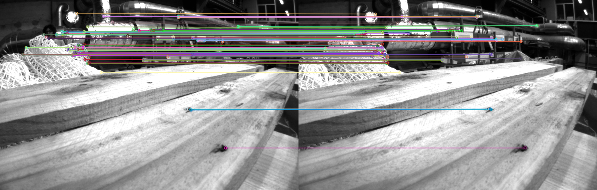
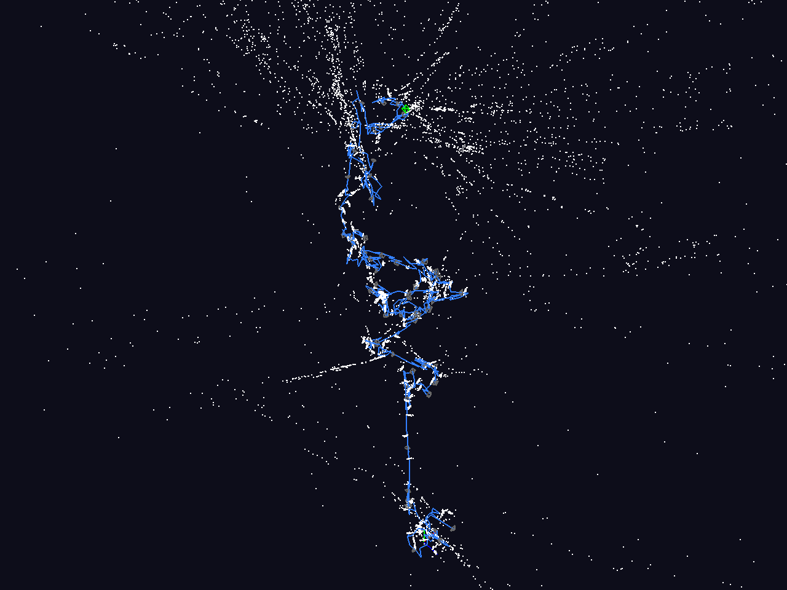
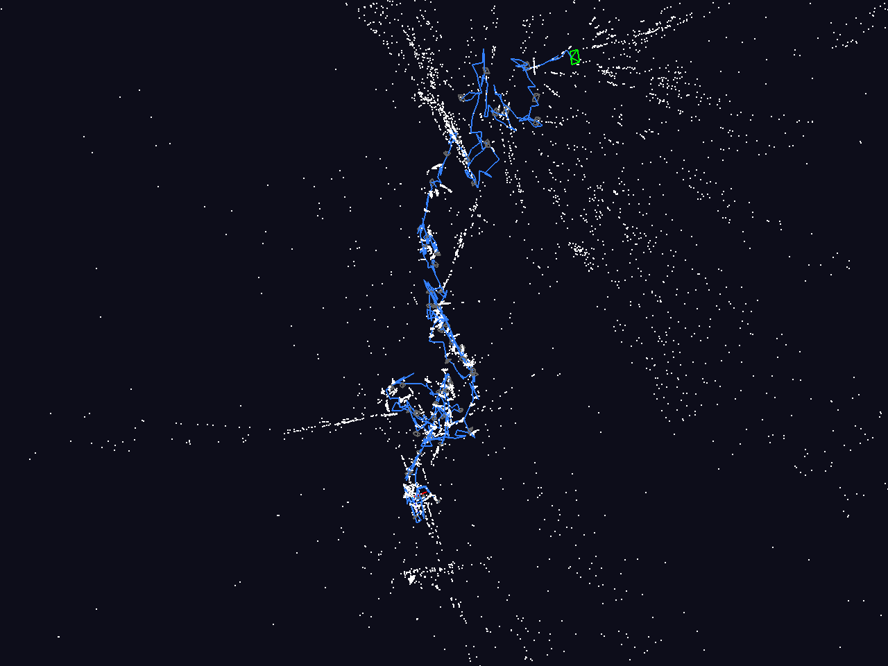

# fujin_uav_slam

> **Fūjin** (風神) — the Japanese god of wind. Monocular visual SLAM for UAVs, built from scratch in Python.

Estimates the drone's trajectory and builds a sparse 3D map from a single camera stream (EuRoC MAV dataset) — no GPS, no IMU, just pixels.

## Showcase

**Feature matching** between consecutive frames (`--debug` view):



**Live 3D viewer** — trajectory (blue), camera frustums (gray/green), triangulated point cloud (white):

| Orbit view | Top-down view |
| --- | --- |
|  |  |

## Pipeline

Feature extraction (ORB/SIFT) → matching (BF/FLANN) → fundamental matrix RANSAC → essential matrix pose recovery → SVD triangulation → pose accumulation → OpenGL 3D viewer.

Bag streaming and the 3D renderer each run in their own process, connected by queues.

**Implemented:** frontend VO, motion estimation, triangulation, real-time 3D viewer.
**Planned:** bundle adjustment, loop closure, long-term tracking.

## Run

Requires Python 3.11 and [uv](https://docs.astral.sh/uv/). Download a sequence from the [EuRoC MAV dataset](https://projects.asl.ethz.ch/datasets/doku.php?id=kmavvisualinertialdatasets) into `data/` (gitignored), then:

```bash
uv venv && uv pip install -r requirements.txt
uv run python src/main.py -bag data/bagfiles/V1_02_medium.bag -topic /cam0/image_raw --debug
```

| Argument | Description |
| --- | --- |
| `-bag` | path to a `.bag` recording (required) |
| `-topic` | mono frame topic (default: `/cam0/image_raw`) |
| `--debug` | show the feature-matching overlay |
| `--no-render` | disable the 3D viewer |

Controls — video window: `q` to quit. 3D viewer: left-drag orbit, right-drag or `+`/`-` zoom, `q`/`ESC` close.

## Learning material

Based on [**Vision Algorithms for Mobile Robotics (VAMR)**](https://rpg.ifi.uzh.ch/teaching.html) — Prof. Davide Scaramuzza, Robotics and Perception Group (UZH / ETH Zürich).

## License

[MIT](LICENSE) © 2024 Moș Daniele
